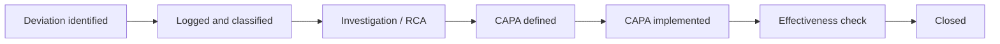
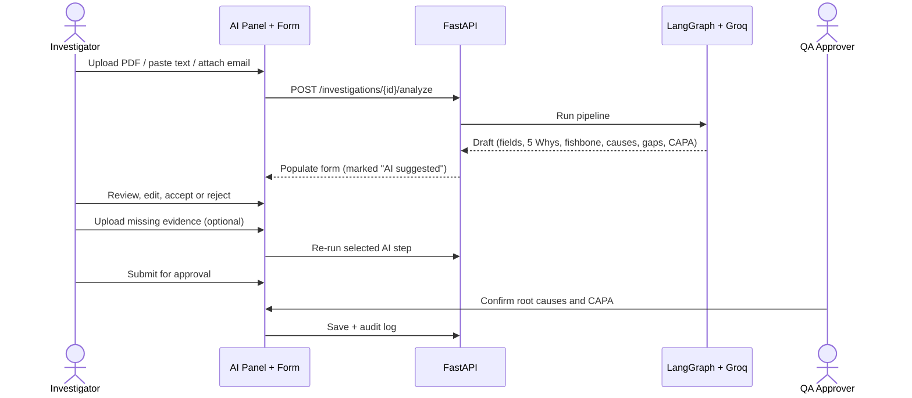
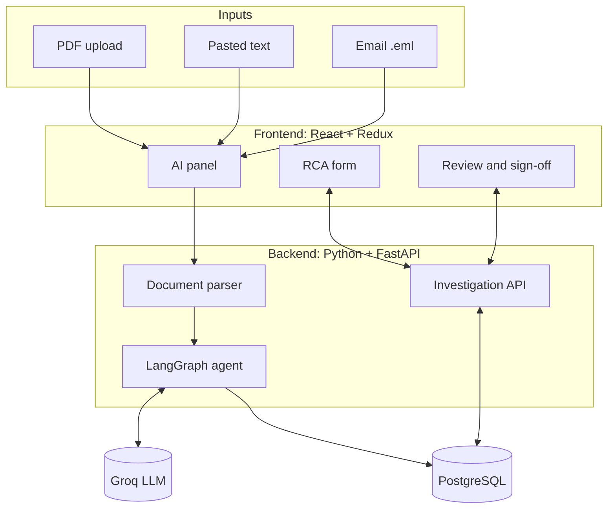
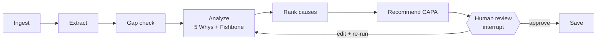
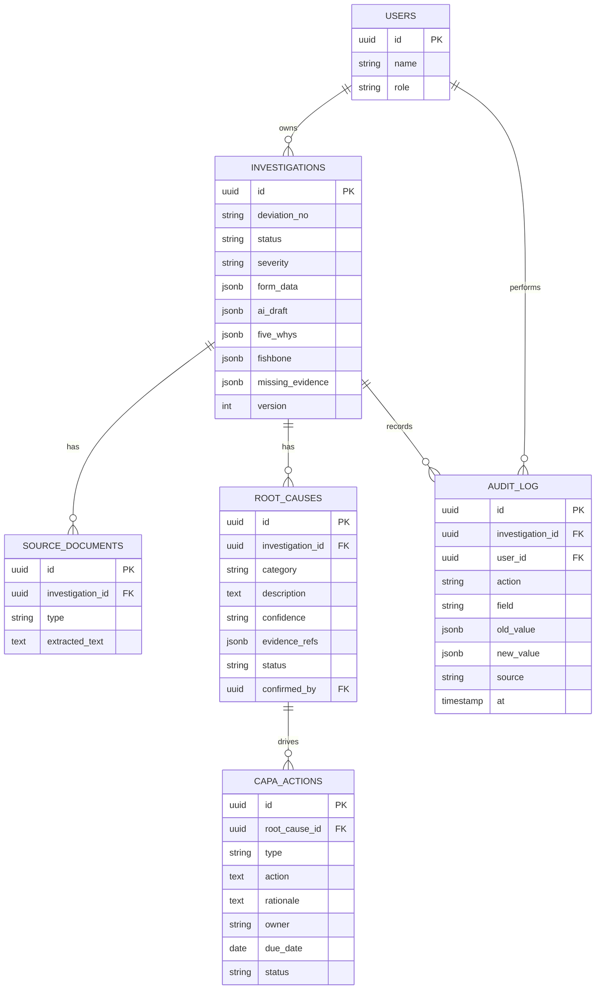

# AI-Assisted Root Cause Analysis (RCA) Module

**For API (Active Pharmaceutical Ingredient) manufacturing quality investigations**

| | |
|---|---|
| **Type** | Web application (AI-assisted workflow tool) |
| **Users** | Quality investigators, QA reviewers and approvers |
| **Stack** | React + Redux · Python + FastAPI · LangGraph + Groq · PostgreSQL |
| **Workflow** | Deviation → Root Cause Analysis → CAPA |

---

## Table of Contents

1. [The Problem](#1-the-problem)
2. [Domain Background](#2-domain-background)
3. [The Solution](#3-the-solution)
4. [How It Meets the Requirements](#4-how-it-meets-the-requirements)
5. [User Workflow](#5-user-workflow)
6. [System Architecture](#6-system-architecture)
7. [AI Pipeline (LangGraph)](#7-ai-pipeline-langgraph)
8. [Data Model](#8-data-model)
9. [API Endpoints](#9-api-endpoints)
10. [Frontend Design](#10-frontend-design)
11. [Human-in-the-Loop and Compliance Rules](#11-human-in-the-loop-and-compliance-rules)
12. [Key Design Decisions](#12-key-design-decisions)
13. [Demo Scenario](#13-demo-scenario)
14. [Risks and Mitigations](#14-risks-and-mitigations)
15. [Out of Scope and Future Work](#15-out-of-scope-and-future-work)
16. [Glossary](#16-glossary)

---

## 1. The Problem

API manufacturers run complex chemical processes under strict Good Manufacturing Practice (GMP) rules. When anything departs from the approved procedure or expected result, it is a **deviation**, and it must be investigated, explained, and fixed.

Today, that investigation is slow and inconsistent:

- **Information is scattered.** The incident arrives as an email, a scanned PDF, or a free-text note. Investigators re-type the same details (batch number, equipment, dates) into a form by hand.
- **Evidence review is manual.** Batch records, equipment logs, lab results, and maintenance history must be read line by line to find what matters.
- **Root causes are often shallow.** Under time pressure, teams stop at the symptom ("temperature was too high") or default to "human error" instead of finding the underlying cause.
- **Gaps go unnoticed.** Missing evidence (no calibration record, no operator interview) is often found late, during QA review or an audit.
- **CAPA quality varies.** Actions are sometimes not linked to a specific root cause, or are corrective only, with nothing to prevent recurrence.
- **Investigations run late.** Deviations typically have a closure deadline (often around 30 days). Delays create compliance risk and hold up batch release.

**In short:** quality professionals spend too much time on data entry and document reading, and too little on judgment.

---

## 2. Domain Background

### 2.1 What is an API?

An **Active Pharmaceutical Ingredient** is the chemical in a medicine that produces its effect. API manufacturing involves steps like reaction, crystallization, filtration, drying, milling, and packing. Each step follows a written procedure and must stay within defined limits. GMP expectations for API manufacturing are described in **ICH Q7**.

### 2.2 The quality workflow



**1. Deviation identification**
Someone notices a departure, such as a temperature excursion, an out-of-specification (OOS) test result, a skipped step, or an equipment failure. It is recorded with what happened, when, where, which batch, and who found it. QA then classifies its **severity**:

| Severity | Meaning | Example |
|---|---|---|
| Critical | Likely impact on product quality or patient safety | Wrong raw material charged |
| Major | Possible impact on quality; needs full investigation | Reactor temperature above limit for 25 minutes |
| Minor | No expected impact on quality | Logbook entry made late |

**2. Root cause analysis**
The investigation finds *why* the deviation happened, backed by evidence. Two common methods:

- **5 Whys:** ask "why?" repeatedly until reaching a cause that, if fixed, would prevent recurrence.
- **Fishbone (Ishikawa) diagram:** sort possible causes into six categories (the "6M"): **Man** (people), **Machine** (equipment), **Method** (procedure), **Material**, **Measurement**, and **Mother Nature** (environment).

Investigators separate the **root cause** (the fundamental reason) from **contributing factors** (conditions that made it more likely or worse).

**3. CAPA**

- **Corrective action:** fixes the problem that occurred (for example, recalibrate the faulty sensor).
- **Preventive action:** stops it happening again, here or elsewhere (for example, add the sensor to the monthly calibration schedule).

Each action has an owner, a due date, and an **effectiveness check** to confirm it worked. Quality systems guidance in **ICH Q10** and risk principles in **ICH Q9** frame how CAPA is managed.

---

## 3. The Solution

An **AI-assisted RCA module** that takes an incident document and helps the investigator move from raw input to an evidence-backed root cause and a CAPA plan, while keeping a qualified person in full control.

> **The AI reads and drafts. The human checks and decides.**

### 3.1 What the module does

| Capability | Description |
|---|---|
| **Multi-format intake** | Accepts a PDF, pasted text, or an email (`.eml`) |
| **AI form population** | Extracts deviation details and fills the RCA form automatically |
| **Guided analysis** | Generates a 5 Whys chain and a 6M fishbone |
| **Root cause suggestions** | Ranks probable root causes and contributing factors, each with linked evidence and a confidence level |
| **Gap detection** | Lists missing evidence or information needed to complete the investigation |
| **CAPA recommendations** | Suggests corrective and preventive actions, each with a short rationale, linked to a root cause |
| **Review and edit** | Every AI field is editable; causes and actions can be accepted, rejected, or changed |
| **Approval and audit** | Nothing is final until approved; every change is logged with who, what, when, and whether it came from AI or a user |

### 3.2 What makes it more than an AI wrapper

- **Structured output, not chat replies.** The AI returns validated JSON that maps onto specific form fields.
- **Evidence-linked reasoning.** Each suggested cause points to the source text that supports it, or is marked as unsupported.
- **Honest uncertainty.** Confidence levels and missing-evidence lists are shown, not hidden.
- **Enforced rules.** The system blocks a cause from being confirmed without evidence and a qualified approver.
- **Traceability.** The original AI draft is stored separately from the human-edited version, so every change can be reviewed.

---

## 4. How It Meets the Requirements

| Requirement | How the module meets it |
|---|---|
| Accept PDF, pasted text, or email | AI panel supports all three; the backend converts each to plain text |
| AI extracts information and populates the form | `Extract` node returns structured fields that fill the RCA form |
| Support 5 Whys or fishbone | `Analyze` node produces both |
| Identify root causes and contributing factors | `Rank causes` node returns ranked, categorized, evidence-linked suggestions |
| Highlight missing evidence | `Gap check` node lists missing items with the reason each is needed |
| CAPA recommendations with short explanation | `Recommend CAPA` node returns actions with a rationale and a linked cause |
| Review and edit before saving | Graph pauses at `Human review`; all fields are editable; save requires approval |
| Form not filled manually as primary workflow | The main flow starts in the AI panel; manual editing is a correction step |
| AI causes treated as suggestions | Causes start as `suggested`; confirming requires evidence and a QA role |

---

## 5. User Workflow



**Step by step:**

1. **Start.** The investigator creates an investigation and opens the AI panel.
2. **Provide input.** They upload a PDF, paste text, or attach an email.
3. **AI drafts.** The form fills in. Every AI-filled field shows an "AI suggested" tag.
4. **Review the details.** The investigator corrects any extracted fields.
5. **Review the analysis.** They inspect the 5 Whys and fishbone, then accept, reject, or edit each suggested cause.
6. **Close gaps.** They add missing evidence and ask the AI to re-run the analysis.
7. **Review CAPA.** They edit actions, owners, and due dates.
8. **Approve.** A QA approver confirms causes and CAPA and signs off. The investigation is saved with a full audit trail.

---

## 6. System Architecture



| Layer | Technology | Responsibility |
|---|---|---|
| Frontend | React, Redux Toolkit, RTK Query | AI panel, RCA form, review screens, state of AI draft vs. user edits |
| Backend | Python, FastAPI, Pydantic | Upload handling, parsing, running the AI pipeline, saving data, audit logging |
| Document parsing | `pdfplumber` / `PyMuPDF`, Python `email` library | Convert PDF and email into plain text |
| AI orchestration | LangGraph | Runs the analysis as separate, re-runnable steps with a human-review pause |
| LLM | Groq (`openai/gpt-oss-120b`) | Extraction and reasoning |
| Database | PostgreSQL (JSONB for AI output) | Investigations, causes, CAPA, documents, audit log, graph checkpoints |

---

## 7. AI Pipeline (LangGraph)

The AI work runs as a graph of eight steps. Each AI step has its own focused prompt and returns JSON validated by a Pydantic model. If validation fails, the step retries once with the validation error included in the prompt.



| # | Node | Input | Output |
|---|---|---|---|
| 1 | **Ingest** | Raw text from parser | Cleaned text, detected source type, document sections |
| 2 | **Extract** | Cleaned text | Form fields: deviation title, date, product, batch no., equipment ID, process step, description, immediate actions, proposed severity |
| 3 | **Gap check** | Extracted fields + text | List of missing information, each with why it matters and a priority |
| 4 | **Analyze** | Fields + evidence | 5 Whys chain; fishbone with possible causes in each 6M category |
| 5 | **Rank causes** | Analysis + evidence | Ranked root causes and contributing factors, each with category, confidence, and evidence quotes |
| 6 | **Recommend CAPA** | Confirmed or suggested causes | Corrective and preventive actions with rationale, suggested owner role, due date, and effectiveness check |
| 7 | **Human review** | Full draft | Graph pauses (LangGraph `interrupt`) until the user approves or edits |
| 8 | **Save** | Approved investigation | Stored record, new version, audit entries |

### 7.1 Example output: one suggested root cause

```json
{
  "id": "rc-1",
  "type": "root_cause",
  "category": "Machine",
  "description": "Temperature sensor TT-101 drifted out of calibration, under-reporting reactor temperature.",
  "confidence": "medium",
  "evidence_refs": [
    {
      "document": "equipment_log.pdf",
      "quote": "TT-101 reading 76.8 C; reference probe 81.2 C",
      "supports": true
    }
  ],
  "missing_evidence": ["Last calibration certificate for TT-101"],
  "status": "suggested"
}
```

### 7.2 Prompting rules applied to every AI step

- Use **only** the provided documents; never invent batch numbers, dates, or readings.
- If a value is not found, return `null` and add it to missing information.
- Every cause must quote its supporting evidence, or set `confidence` to `low` and say it is unsupported.
- Do not default to "human error" without explaining why the system allowed the error.
- Return JSON only, matching the given schema.

### 7.3 Model choice

The assignment lists `gemma2-9b-it` and `llama-3.3-70b-versatile`. Both have since been retired by Groq, so the module uses **`openai/gpt-oss-120b`**, which Groq recommends as a replacement. The model name is read from the `GROQ_MODEL` environment variable, so it can be changed without code changes.

---

## 8. Data Model



**Key points:**

- `ai_draft` keeps the untouched AI output; `form_data` holds what the human kept. Comparing them shows exactly what was changed.
- `AUDIT_LOG` is append-only. `source` is either `ai` or `user`.
- Status values:
  - Investigation: `draft → in_review → approved → closed`
  - Root cause: `suggested → confirmed | rejected`
  - CAPA action: `proposed → accepted → in_progress → completed → verified`

---

## 9. API Endpoints

| Method | Endpoint | Purpose |
|---|---|---|
| `POST` | `/investigations` | Create a new investigation |
| `GET` | `/investigations` | List investigations with status and severity |
| `GET` | `/investigations/{id}` | Get one investigation with causes, CAPA, and documents |
| `POST` | `/investigations/{id}/documents` | Upload a PDF or email, or submit pasted text |
| `POST` | `/investigations/{id}/analyze` | Run the full AI pipeline |
| `POST` | `/investigations/{id}/analyze/{step}` | Re-run one step (for example `capa` after editing causes) |
| `PATCH` | `/investigations/{id}` | Save user edits to form fields |
| `PATCH` | `/root-causes/{id}` | Edit, confirm, or reject a root cause |
| `PATCH` | `/capa/{id}` | Edit or update a CAPA action |
| `POST` | `/investigations/{id}/approve` | QA approval (role-checked) |
| `GET` | `/investigations/{id}/audit` | Full audit trail |

---

## 10. Frontend Design

### 10.1 Layout

```
+---------------------------+------------------------------------------+
|        AI PANEL           |              RCA FORM                    |
|                           |  [ Details ][ Evidence ][ Analysis ]     |
|  [ Upload PDF ]           |  [ Root causes ][ CAPA ][ Review ]       |
|  [ Paste text ]           |                                          |
|  [ Attach email ]         |  Deviation title   [AI suggested]  edit  |
|                           |  Batch no.         [AI suggested]  edit  |
|  > Analyze                |  Equipment         [AI suggested]  edit  |
|                           |  ...                                     |
|  Progress:                |                                          |
|   ✓ Extracted 12 fields   |  Missing evidence                        |
|   ✓ 3 gaps found          |   ! Calibration record for TT-101        |
|   … Analyzing             |   ! Operator interview                   |
|                           |                                          |
|  Ask AI: "Why is rc-1     |                                          |
|  medium confidence?"      |                                          |
+---------------------------+------------------------------------------+
```

### 10.2 Form sections

| Tab | Contents |
|---|---|
| **Details** | Deviation no., title, date, product, batch, equipment, process step, description, immediate actions, severity |
| **Evidence** | Uploaded documents, extracted text, highlighted passages the AI used |
| **Analysis** | Editable 5 Whys chain and fishbone diagram |
| **Root causes** | Cards with category, confidence, evidence quotes, and Confirm / Reject / Edit |
| **CAPA** | Actions grouped by cause, split into corrective and preventive, with owner and due date |
| **Review** | Summary, AI-vs-final comparison, audit trail, approve button |

### 10.3 Visual signals

- **AI suggested** tag on any AI-filled value, removed once a user edits or accepts it
- **Confidence badge** (high / medium / low) on each root cause
- **Evidence count** on each cause; "No evidence" shown in warning color
- **Edited** marker when a user changed an AI value

### 10.4 Redux slices

| Slice | Holds |
|---|---|
| `investigation` | Current form data and status |
| `aiDraft` | Original AI output for comparison |
| `aiPanel` | Input, pipeline progress, errors |
| `review` | Accept/reject decisions and approval state |

---

## 11. Human-in-the-Loop and Compliance Rules

These rules are enforced by the backend, not just the UI.

1. **AI output is always a suggestion.** Every AI-generated cause starts as `suggested`.
2. **Confirmation needs evidence.** A root cause cannot be confirmed unless at least one evidence reference is attached.
3. **Confirmation needs a qualified person.** Only a user with the `qa_approver` role can confirm causes or approve the investigation.
4. **No silent saves.** The AI pipeline cannot write final records; it stops at the human-review interrupt.
5. **Every change is logged.** Field edits, accept/reject decisions, and approvals all create an audit entry.
6. **Every CAPA links to a cause.** An action without a root cause cannot be saved.
7. **Original AI output is kept.** The AI draft is never overwritten.

These principles reflect common GMP expectations for data integrity (attributable, traceable, and reviewable records). Full regulatory compliance, such as validated electronic signatures under 21 CFR Part 11, is out of scope for this prototype.

---

## 12. Key Design Decisions

| Decision | Choice | Reason |
|---|---|---|
| Input handling | Convert every format to plain text first | One consistent input for the AI |
| AI structure | Eight small LangGraph steps instead of one large prompt | Better accuracy, easier debugging, individual steps can be re-run |
| Output format | JSON validated with Pydantic | Reliable mapping to form fields |
| Human control | LangGraph `interrupt` before save | Guarantees human approval |
| Model | `openai/gpt-oss-120b`, configurable | Strong reasoning; easy to swap |
| Data storage | PostgreSQL with JSONB | Structured core fields plus flexible AI output |
| Draft vs. final | Separate `ai_draft` and `form_data` | Clear record of human changes |
| Roles | Investigator and QA approver | Mirrors real quality team duties |
| Layout | AI panel beside the form | Shows AI filling the form live |

---

## 13. Demo Scenario

**Deviation DEV-2026-041: Assay failure in Batch API-B-2307**

> During the crystallization step of Batch API-B-2307, reactor R-201 exceeded the 80 °C limit for about 25 minutes. The final assay result was 97.2% against a specification of ≥ 99.0%.

**Sample documents for the demo:**

| Document | Key content |
|---|---|
| Deviation report (PDF) | Description of the excursion, batch, and test result |
| Equipment log | Sensor TT-101 reading lower than a reference probe |
| Maintenance record | Cooling valve CV-12 service overdue by 3 weeks |
| Lab results | Impurity levels above normal |
| Shift notes (email) | Operator noted an alarm but saw normal readings on screen |
| Past deviation | Similar excursion on R-201 six months earlier |

**What the AI should produce:**

- **Likely root cause:** sensor TT-101 out of calibration (Machine / Measurement), so the excursion was not detected in time
- **Contributing factors:** overdue cooling valve maintenance; alarm not escalated; repeat issue not acted on
- **Missing evidence:** TT-101 calibration certificate, operator interview, valve inspection report
- **CAPA:**
  - Corrective: recalibrate TT-101; service CV-12; assess impact on Batch API-B-2307
  - Preventive: add TT-101 to the calibration schedule; add a valve maintenance overdue alert; retrain on alarm escalation; trend repeat deviations on R-201

---

## 14. Risks and Mitigations

| Risk | Mitigation |
|---|---|
| AI invents facts | Evidence quotes required; `null` for missing values; human review |
| Overconfident suggestions | Confidence levels and missing-evidence lists shown on every cause |
| Invalid JSON from the model | Pydantic validation with one automatic retry |
| Model retired by Groq | Model set by environment variable |
| Scanned PDFs with no text layer | Detect empty text and prompt the user to paste content (OCR in future work) |
| Sensitive data sent to an external API | Use demo data only; document data handling for production use |
| Long documents exceed context | Split by section in the Ingest step |

---

## 15. Out of Scope and Future Work

**Out of scope for this prototype:**
- Validated electronic signatures (21 CFR Part 11)
- Integration with real QMS, LIMS, or MES systems
- OCR for scanned documents
- CAPA effectiveness tracking over time

**Future work:**
- Search past deviations to flag recurring problems automatically
- OCR support for scanned PDFs
- CAPA dashboard with overdue alerts
- Export the approved investigation as a formatted report
- Trend analysis across equipment, products, and sites

---

## 16. Glossary

| Term | Meaning |
|---|---|
| **API** | Active Pharmaceutical Ingredient: the medically active chemical in a drug |
| **GMP** | Good Manufacturing Practice: rules for making medicines safely and consistently |
| **ICH Q7 / Q9 / Q10** | International guidelines on API GMP, quality risk management, and quality systems |
| **Deviation** | Any departure from an approved procedure or expected result |
| **OOS** | Out of Specification: a test result outside allowed limits |
| **RCA** | Root Cause Analysis: finding the underlying reason for a problem |
| **5 Whys** | Asking "why?" repeatedly to reach the root cause |
| **Fishbone / Ishikawa** | Diagram grouping possible causes into categories (6M) |
| **CAPA** | Corrective and Preventive Action |
| **SOP** | Standard Operating Procedure |
| **QA** | Quality Assurance |
| **Audit trail** | Record of who did what, when, and why |
| **LangGraph** | Framework for building multi-step AI workflows |
| **Groq** | Provider that runs open AI models with fast responses |
